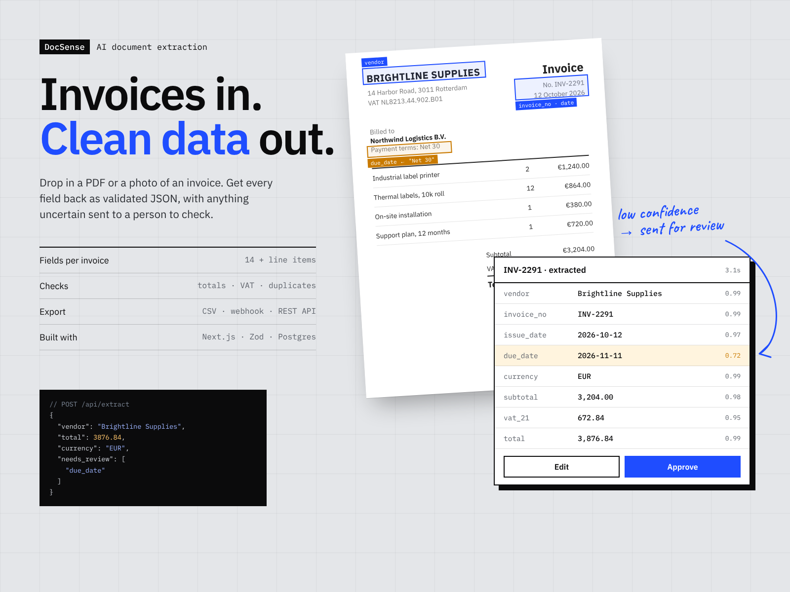
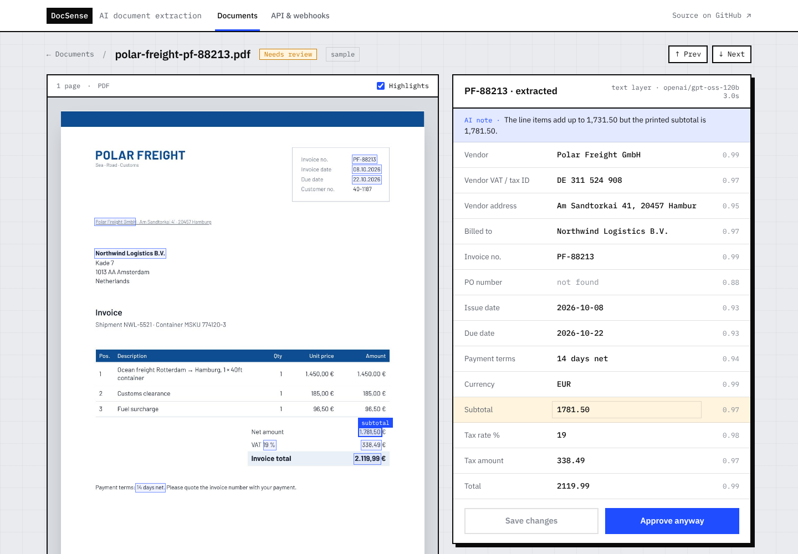
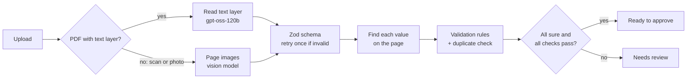

# DocSense

AI invoice and receipt extraction. Drop in a PDF or a photo and get clean, validated data back. Every field gets a confidence score and is highlighted on the document. The math is checked, and anything uncertain goes to a person before it reaches your accounting system.



**Live demo:** https://docsense-demo.vercel.app

Each visitor gets a private workspace pre-filled with five sample documents. Upload your own invoice, or click **Run** next to a sample to watch the AI extract it live. Uploads are deleted after 24 hours.

## What it does

- **Upload anything.** PDFs, scans and phone photos. Drag and drop several at once.
- **14 fields + line items.** Vendor, VAT/tax ID, address, customer, invoice and PO numbers, issue and due dates, payment terms, currency, subtotal, tax rate, tax amount, total, and every line item.
- **Confidence per field.** The model scores each value. DocSense then looks for the value on the document itself: if it isn't printed there (say, a due date worked out from "Net 30"), the score is lowered and the field goes to review.
- **Highlights on the document.** Hover a field to see where it came from on the page.
- **Validation rules.** Line items must add up to the subtotal, quantity × price must equal each line amount, tax must match the rate, subtotal + tax must equal the total, the due date must come after the issue date, and the same vendor + invoice number can't be booked twice.
- **Review queue.** Needs review, ready, approved. Fix a value, approve, reopen. Every edit is recorded with its before and after values.
- **Export.** CSV (one row per invoice, or one per line item), signed webhooks, and a REST API.



## How extraction works



1. The browser renders PDF pages to images with PDF.js and uploads the file straight to storage through signed URLs (no 4.5 MB serverless body limit).
2. If the PDF has a text layer, the server reads it with [unpdf](https://github.com/unjs/unpdf) and sends the text to a fast text model. That's cheaper and more exact than a vision model. Scans and photos go to a vision model as images.
3. The model must return JSON matching a Zod schema. If it doesn't, it's asked once more with the validation error.
4. Each value is searched for in the PDF's text layer, in all the usual formats (`3,204.00`, `3.204,00`, `12 October 2026`, `12.10.2026`…). Found values get a highlight box; values that aren't on the page lose confidence.
5. The validation rules run, and the document lands in **Ready** or **Needs review**.

Document text is treated as data: the prompt tells the model to ignore instructions inside documents, and the model has no tools, so a malicious PDF can't make it do anything except fill in fields.

## Tech stack

| Part | Choice |
|---|---|
| App | Next.js 15 (App Router, server actions), React 19, TypeScript |
| UI | Tailwind CSS 4, IBM Plex Sans + Mono |
| AI | Vercel AI SDK 5 `generateObject` + Zod. Groq `openai/gpt-oss-120b` for text, `qwen/qwen3.8-27b` for images; Gemini as a fallback |
| PDF | PDF.js in the browser (page images), unpdf on the server (text layer) |
| Data | Supabase Postgres (documents, audit events) and Storage (private bucket, signed URLs) |
| Hosting | Vercel, with a daily cron that deletes expired uploads |

## REST API

```bash
curl -F "file=@invoice.pdf" https://docsense-demo.vercel.app/api/extract
```

Returns the fields, a confidence score for each, line items, the validation results and a `needs_review` list. Nothing is stored. The demo allows 10 requests per hour per IP.

## Webhooks

Set a URL on the **API & webhooks** page. DocSense sends `document.extracted` and `document.approved` events, signed with HMAC-SHA256:

```
x-docsense-timestamp: 1760000000
x-docsense-signature: sha256=<hex of HMAC(secret, timestamp + "." + body)>
```

Webhook URLs must be public `https://` addresses; private and internal networks are blocked.

## Run it locally

You need Node.js 20 or newer.

```bash
npm install
cp .env.example .env.local    # add GROQ_API_KEY
npm run dev                   # http://localhost:3000
```

With no Supabase keys, the app runs in memory. With no AI key at all, set `EXTRACT_MOCK=1` to click through the app with the sample answers.

### With Supabase

1. Create a Supabase project.
2. Run [`supabase/schema.sql`](supabase/schema.sql) in the SQL Editor. It creates the tables and a private `documents` storage bucket.
3. Add `SUPABASE_URL` and `SUPABASE_SERVICE_ROLE_KEY` (Project Settings → API keys, the secret key) to `.env.local`.

## Deploy to Vercel

1. Push the repo to GitHub and import it in Vercel.
2. Add the environment variables from `.env.example`, including a random `CRON_SECRET`.
3. Deploy. `vercel.json` schedules the daily cleanup.

## Project structure

```
app/
  page.tsx                      upload + document queue
  documents/[id]/               review screen and its server actions
  developers/                   API docs and webhook settings
  api/documents/                create upload → signed URLs, run extraction
  api/extract/                  public stateless REST endpoint
  api/export/                   CSV export
  api/cron/cleanup/             daily retention job
components/                     Uploader, Review, WebhookForm…
lib/
  fields.ts                     the 14 fields and the Zod schema
  extract.ts                    model choice, prompt, retry
  analyze.ts                    text layer vs vision, confidence adjustment
  locate.ts                     finds values on the page (highlight boxes)
  validate.ts                   validation rules and review status
  documents.ts                  upload, extract, edit, approve, webhooks
  store.ts                      Supabase store with an in-memory fallback
  webhook.ts                    signed delivery with SSRF protection
content/samples.json            the bundled sample documents and their answers
scripts/build-samples.ts        precomputes highlight boxes for the samples
supabase/schema.sql             tables, indexes, storage bucket
```

## Adapting it

- **Different documents** (purchase orders, bank statements, contracts): change `lib/fields.ts` and the rules in `lib/validate.ts`.
- **Your accounting system:** point the webhook at it, or call QuickBooks/Xero from `notify()` in `lib/documents.ts`.
- **Real users:** swap the anonymous workspace cookie for Supabase Auth or Clerk; everything is already scoped by workspace.

## License

MIT
